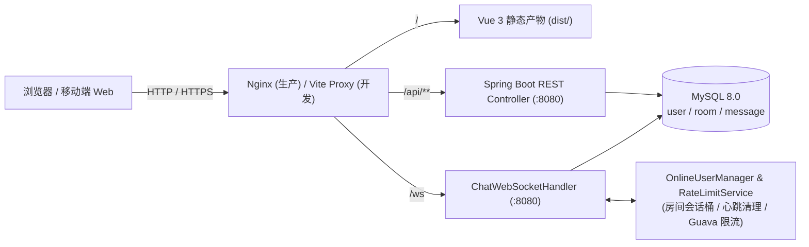

<div align="center">

# MyChat

**轻量、极简、开箱即用的实时多聊天室 Web 应用**

类 iOS 磨砂双主题界面 · 无需注册即刻开聊 · 公开 / 私密房间 · 分享链接直达 · 生产级限流与心跳保活


</div>

---

## ✨ 核心特性

- **多聊天室与隐私保护**
  - 支持自由创建 **公开房间** 与 **私密房间**，后端自动生成 6 位唯一房间号，私密房密码采用 `BCrypt` 加密落库。
  - 无全站房间列表，通过精确房号或分享链接进入；输入不存在的房号提示「房间未创建」，私密房需通过服务端强校验密码（WebSocket 握手入房阶段强制二次鉴权，防止绕过）。
- **分享链接与快捷回房**
  - 进入聊天室后一键复制房间分享链接（`/?room=<房间号>`）；他人打开链接后展示目标房间信息与实时在线人数，**进入前需输入/确认用户名**（私密房同步校验密码）。
  - 自动通过 Cookie 记录最近进过的房间（最多 10 个），下次登录展示历史房间列表及实时在线人数，公开房一键快进、私密房原地验密进入。
- **零门槛游客身份**
  - 无需注册与账密，基于 `HttpOnly` + `SameSite=Lax`（HTTPS 自动附加 `Secure`）的 `guest_id` Cookie 记住设备身份，自定义昵称与 6 款头像主题色，支持随时修改或清除本机记录。
- **精致流畅的聊天体验**
  - **类 iOS 视觉与双主题**：磨砂顶栏/输入栏，自动跟随系统并支持一键切换浅色/暗黑模式。
  - **历史消息向上滚动分页**：基于联合索引 `(room_id, id)` 游标分页拉取，向上翻阅时自动锚定滚动位置零抖动，断线重连保留已翻阅历史。
  - **350+ 精选 Emoji 面板**：8 大分类、自动记忆最近使用、支持中英文关键词搜索。
  - **移动端深度适配**：基于 `visualViewport` 实时贴合手机虚拟键盘高度与偏移，适配 iPhone 底部安全区、防 iOS Safari 自动放大与键盘/表情面板冲突。
- **生产级安全与稳定性**
  - **全链路限流防刷**：基于 Guava 有界过期缓存，覆盖创建房间、查房防枚举、私密房猜密锁定（连错 5 次锁 120 秒）、跨多标签页统一消息限流、单 IP 并发连接上限与帧体积保护。
  - **双向心跳与僵尸连接清理**：前端 25 秒心跳 + 10 秒超时主动重连 + 前台/联网即时唤醒；后端每 30 秒定时扫描并踢除超时半开连接与未入房空占连接，确保在线成员准确。

---

## 🛠️ 技术栈

| 层级 | 技术选型 |
| :--- | :--- |
| **后端框架** | Java 21 · Spring Boot 3.4.3 · Spring WebSocket (Native) · Spring Security |
| **数据持久层** | MyBatis-Plus 3.5.10 · MySQL 8.0 · HikariCP |
| **限流与工具** | Guava Cache · Lombok · SLF4J / Logback · SpringDoc OpenAPI |
| **前端框架** | Vue 3.5 · TypeScript · Vite 8 · Tailwind CSS 4 · Lucide Icons |
| **部署运维** | Nginx（静态托管 + API/WS 反向代理）· systemd · 本地一键部署脚本 |

---

## 📐 架构与通信协议

### 总体架构



### 核心 REST API

| 方法与路径 | 说明 |
| :--- | :--- |
| `GET /api/auth/me` | 读取/签发游客 `guest_id` Cookie，返回上次记住的昵称与头像色 |
| `POST /api/auth/clear` | 清除本机 `guest_id` 与 `recent_rooms` Cookie（不删库记录） |
| `POST /api/rooms` | 创建公开/私密房间，返回 6 位唯一 `code`（带频控） |
| `GET /api/rooms/{code}` | 查询房间是否存在、名称、是否私密与实时在线人数（不暴露密码） |
| `GET /api/rooms/recent` | 根据 `recent_rooms` Cookie 批量返回最近进过房间的实时信息 |

### WebSocket 协议（`/ws`，扁平 JSON 帧）

| 方向 | `type` | 载荷示例 | 说明 |
| :--- | :--- | :--- | :--- |
| C → S | `join` | `{ nickname, avatarColor, roomCode, password? }` | 入房与私密房密码强校验 |
| C → S | `message:send` | `{ content, clientTempId }` | 发送文本消息（≤ 500 字） |
| C → S | `history:load` | `{ beforeId, limit? }` | 向上游标分页拉取更早历史消息 |
| C → S | `ping` / `leave` | `{}` | 心跳保活 / 主动离开当前房间 |
| S → C | `sync:init` | `{ room, self, messages, hasMoreHistory, onlineUsers }` | 入房初始化快照（最近 50 条） |
| S → C | `history:page` | `{ roomCode, messages, hasMore }` | 历史分页结果 |
| S → C | `message:new` | `{ roomCode, message, clientTempId? }` | 新消息或系统入/离房通知 |
| S → C | `presence:update` | `{ roomCode, onlineUsers }` | 当前房间去重在线成员更新 |
| S → C | `pong` / `error` | `{ timestamp }` / `{ code?, message }` | 心跳回执 / 业务与限流错误 |

---

## 🛡️ 内置安全与限流策略

| 防护项 | 默认规则 |
| :--- | :--- |
| 创建房间 | 单访客 `3 次 / 分钟` 且单 IP `6 次 / 分钟`（超限 HTTP `429`） |
| 查询房间（防枚举） | 单 IP `30 次 / 分钟`（超限 HTTP `429`） |
| 私密房猜密码保护 | 同房间 10 分钟内连错 `5 次` → 锁定 `120 秒`（`PASSWORD_LOCKED`），输对清零 |
| WS 入房 / 发消息 / 翻页 | 入房 `20 次 / 分钟(IP)`；发消息 `10 条 / 10 秒(访客)` + `30 条 / 10 秒(IP)`；翻页 `20 次 / 10 秒` |
| WS 连接与帧保护 | 单 IP 最多 `20` 并发连接；单帧上限 `4KB`（缓冲 `8KB`） |
| 僵尸连接清理 | 服务端每 `30 秒` 扫描：已入房 `90 秒` 无心跳或未入房 `30 秒` 自动回收并广播更新 |

---

## 📁 目录结构

```text
MyChat/
├── src/main/java/org/zz/mychat/
│   ├── config/          # Spring Security、WebSocket 握手拦截与 Origin 配置
│   ├── controller/      # GuestAuthController、RoomController 等 REST 控制器
│   ├── domain/          # User、Room、Message 数据库实体
│   ├── mapper/          # MyBatis-Plus Mapper
│   ├── service/         # GuestService、RoomService、MessageService、RateLimitService
│   ├── websocket/       # ChatWebSocketHandler、OnlineUserManager、GuestUser
│   └── common/          # ApiResult、ClientIpUtils、JWT 过滤与枚举
├── src/main/resources/
│   ├── db/
│   │   ├── init.sql     # 全新环境建表脚本（user / room / message）
│   │   └── schema.sql   # 旧库增量升级脚本
│   └── application.yml  # 基础配置（本地开发建议使用 application-dev.yml 覆盖）
├── src/test/java/       # 限流、会话管理、历史分页单元测试
├── frontend/            # Vue 3 + Vite + Tailwind CSS v4 前端工程
├── scripts/
│   └── deploy.sh        # 本地 SSH 免密一键部署与回滚脚本
├── DEPLOY.md            # 服务器生产部署手册（Nginx + systemd + MySQL）
└── ROADMAP.md           # 项目后续持续优化路线图
```

---

## 🚀 快速开始（本地开发）

### 环境要求
- **JDK 21**
- **Node.js ≥ 20.19**（推荐 22 LTS）
- **MySQL 8.0+**

### 1. 初始化数据库

创建数据库并导入建表脚本 [src/main/resources/db/init.sql](src/main/resources/db/init.sql)：

```bash
mysql -u root -p -e "CREATE DATABASE IF NOT EXISTS mychat DEFAULT CHARACTER SET utf8mb4;"
mysql -u root -p mychat < src/main/resources/db/init.sql
```

### 2. 配置本地数据库（推荐 `application-dev.yml`）

在 `src/main/resources/` 下新建 `application-dev.yml`（已在 `.gitignore` 中忽略，不会误提交）：

```yaml
spring:
  datasource:
    url: jdbc:mysql://127.0.0.1:3306/mychat?useUnicode=true&characterEncoding=UTF-8&serverTimezone=Asia/Shanghai
    username: root
    password: your_local_password

mychat:
  security:
    allowed-origin-patterns: "*"
```

### 3. 启动后端（端口 `8080`）

```bash
./mvnw spring-boot:run -Dspring-boot.run.profiles=dev
```

### 4. 启动前端（端口 `5173`，自动代理 `/api` 与 `/ws`）

```bash
cd frontend
npm install
npm run dev
```

浏览器打开 `http://localhost:5173`，输入昵称即可创建房间、复制分享链接并在无痕窗口体验多人实时聊天。

---

## 🧪 测试与构建

```bash
# 后端核心单元测试（不依赖外部数据库）
./mvnw test -Dtest=RateLimitServiceTest,OnlineUserManagerTest,MessageServiceTest

# 后端打包
./mvnw clean package -DskipTests

# 前端类型检查与生产构建
npm --prefix frontend run lint
npm --prefix frontend run build
```

---

## 📦 生产部署与一键发布

- **首次服务器部署**（安装环境、导入 SQL、配置 `systemd` 与 `Nginx` 反代）：请参阅 [DEPLOY.md](DEPLOY.md)。
- **日常一键发布**：配置好 SSH 免密别名 `mychat-prod` 后，直接使用 [scripts/deploy.sh](scripts/deploy.sh)：

```bash
./scripts/deploy.sh all        # 跑单测、打包并同时发布前后端（含健康检查与失败自动回滚）
./scripts/deploy.sh frontend   # 仅构建并同步前端静态文件（零中断）
./scripts/deploy.sh backend    # 仅发布后端并重启服务
./scripts/deploy.sh rollback   # 一键回滚后端至上一版 .jar.bak
./scripts/deploy.sh status     # 查看线上服务状态与健康探测
```

> 生产环境建议通过环境变量覆盖数据源密码、启用 HTTPS（自动激活 Cookie `Secure` 标记），并将 `mychat.security.allowed-origin-patterns` 收紧至实际前端域名。

---
-
## 🤝 参与贡献

欢迎提交 Issue 反馈问题或发起 Pull Request 一起完善 MyChat！
